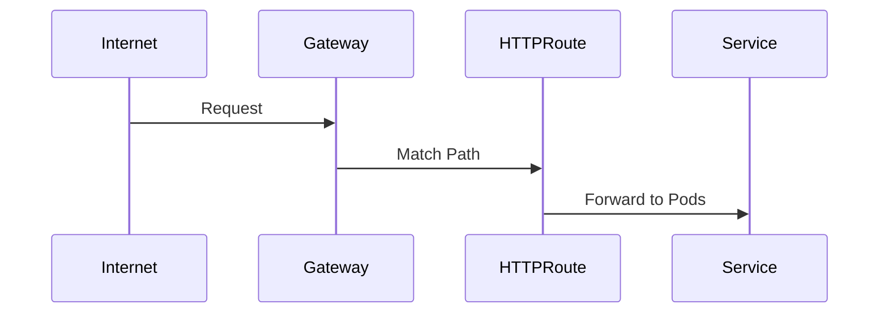
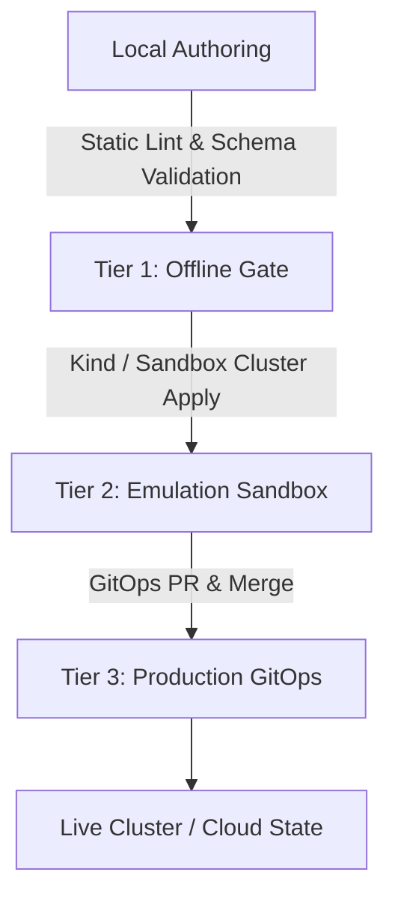
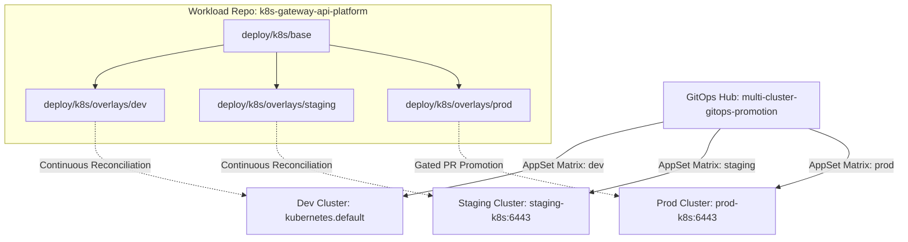

# Architecture: Gateway API
> Maturity: Lab / Reference Implementation

## System Diagram
The following Mermaid.js sequence diagram maps the core workflow and interactions:

## Role-Oriented Model
The standard Kubernetes Ingress is a single object. If a developer wants to add a new route, they must edit the Ingress object, which also contains the TLS certificate configuration and the Load Balancer definition. This is a massive security and stability risk.

The Gateway API introduces three personas:
1. **Infrastructure Provider** (Cloud Provider) → Defines the `GatewayClass`
2. **Cluster Operator** (Platform Team) → Deploys the `Gateway`
3. **Application Developer** (Dev Team) → Deploys the `HTTPRoute`

## Security Boundaries via `allowedRoutes`
In this architecture, the `Gateway` resides in the highly-secured `platform-system` namespace. It terminates TLS using a wildcard certificate that developers cannot access. 

The Gateway explicitly trusts routes coming from namespaces labeled `shared-gateway-access: "true"`. The Developer deploys an `HTTPRoute` in their own `payment-system` namespace. The Gateway API controller automatically binds the Developer's route to the Platform's gateway.

This achieves complete decoupling of infrastructure provisioning from application routing.

## Verification & Deployment Architecture (v0.2.0)

This repository follows a progressive verification architecture designed for zero-trust cloud native environments:

- **Tier 1 (Offline Validation):** Syntax validation, static policy checks (`opa test`, `kyverno test`, `terraform fmt -check`), and schema verification without cloud dependencies.
- **Tier 2 (Sandbox Emulation):** Automated testing against local Kind clusters or isolated development namespaces.
- **Tier 3 (Production GitOps):** Automated deployment via GitOps controllers (ArgoCD / Flux) or infrastructure pipelines with cryptographically signed release manifests and SPDX SBOMs.

## Declarative GitOps & Multi-Cluster Deployment Architecture (v0.2.1)

This service participates in the portfolio-wide **ArgoCD Hub-and-Spoke GitOps continuous delivery catalog**:

### GitOps Topology & Separation of Concerns
1. **Base Manifests (`deploy/k8s/base`):** Declares non-root PodSecurity standards (`runAsUser: 10001`, `drop: [ALL]`, `readOnlyRootFilesystem: true`), readiness/liveness HTTP probes, and CPU/memory requests and limits without hardcoding namespace.
2. **Environment Overlays (`deploy/k8s/overlays/`):**
   - `dev/`: 1 replica, `300m/256Mi` limit, automated drift self-healing.
   - `staging/`: 2 replicas, `500m/512Mi` limit, automated drift self-healing.
   - `prod/`: 3 replicas, `1000m/1Gi` limit, gated pull-request review.
3. **ArgoCD Declarations (`deploy/argocd/`):** Houses standalone `Application` CRDs (`application.yaml`, `application-dev.yaml`, `application-prod.yaml`) and values overrides for OCI Helm and Kustomize reconciliation.
